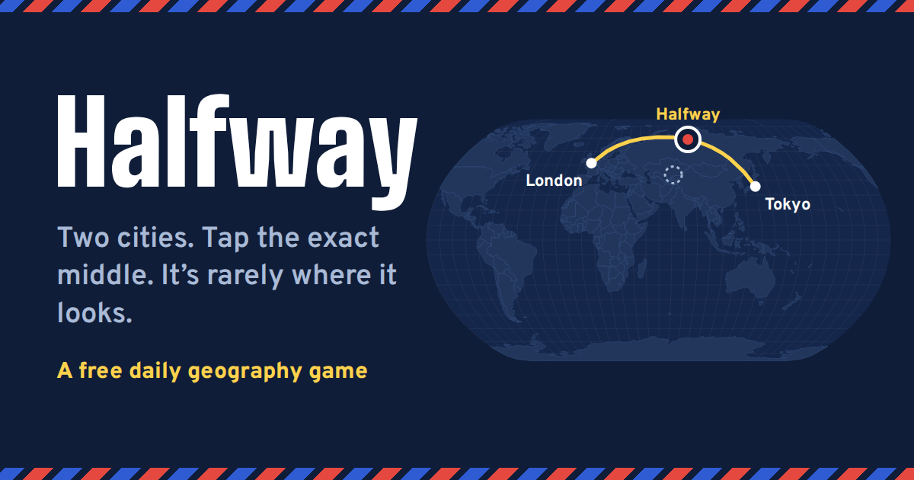

<p align="center">
  <a href="https://pppp575.github.io/Halfway/"></a>
</p>

<h1 align="center">Halfway</h1>

<p align="center"><b>Two cities. One map. Find the exact middle.</b><br>A free daily geography game.</p>

<p align="center"><a href="https://pppp575.github.io/Halfway/"><b>▶ Play today’s Halfway</b></a></p>

---

## How to play

1. Every day you get five pairs of cities, the same for everyone.
2. Tap the spot exactly halfway between them along the shortest route, the way a plane flies.
3. Lock in your pin and watch the map fold into a globe while a plane flies the route.
4. Score up to 100 points a round, 500 a day, then share your result:

```
Halfway No. 12: 412/500 (#3 of 128)
🟩🟨🟩🟧🟩
```

## Why it’s harder than it looks

On a flat map, the straight line between two cities looks like the shortest way. It isn’t. The Earth is round, so the shortest route curves toward the pole, and the true middle is often hundreds or thousands of kilometres from where your eye expects it. Halfway between London and Tokyo isn’t over Iran or India. It’s in northern Siberia, near the city of Norilsk.

## What’s inside

- **A new puzzle every day**, from a short hop to an ocean crossing
- **The globe reveal**: see the real flight path and the flat-map trap
- **Live leaderboards** for today and all time
- **Private leagues** for friends, family or coworkers, with a weekly table
- **See where everyone else tapped** after each round
- **Hard mode** with no city dots, an **archive** of past days and unlimited **practice**
- **Badges, streaks and stats**, plus a share image made for social media
- Works on phones and computers, can be installed like an app, and plays offline

---

## For developers

Built with [Vite](https://vite.dev), [d3-geo](https://d3js.org/d3-geo) and [Supabase](https://supabase.com), and published to GitHub Pages on every push to `main`.

```bash
npm install
npm run dev
```

Guides: [database setup](docs/SUPABASE.md), [publishing](docs/DEPLOY.md), [how it works](docs/ARCHITECTURE.md) and the [roadmap](docs/ROADMAP.md).

## License

All rights reserved. Third-party code, map data and fonts keep their own licenses, listed in [THIRD_PARTY_NOTICES.md](THIRD_PARTY_NOTICES.md).
